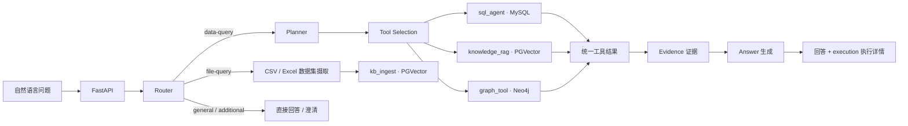

# 基于 LangGraph 的多源数据分析 Agent

GustoBot 是一个基于 **FastAPI + LangGraph** 的 Data Agent 作品集项目。用户用自然语言提问，系统判断请求类型、拆解数据任务、选择工具，并查询 MySQL、PostgreSQL/PGVector 或 Neo4j。查询结果会附带结构化执行状态和证据，供回答、Vue 控制台和端到端评测使用。

默认演示场景是 **Synthetic Enterprise Retail（合成企业零售数据）**。仓库中的零售客户、订单、商品、供应商和政策均为演示资产，不代表真实企业的生产数据。本项目适合本地技术演示；未实现生产环境所需的身份认证、权限控制和租户隔离。

## 请求如何运行



Router 负责选择对话、澄清、数据查询或文件摄取流程；Planner 和 Tool Selection 负责数据任务及工具选择。正式数据工具只有三个：

- **SQL**：Text2SQL 查询 MySQL。SQLGlot 解析和校验表、字段及歧义，配合只读策略、结果行数上限、数据库超时和最多一次受控修复。
- **RAG**：通过 `kb_ingest` 检索 PGVector 中的政策、SOP、供应商 SLA 等文档。企业零售与历史 Recipe 文档使用显式 domain 隔离，摄取采用稳定文档身份去重。
- **Graph**：查询 Neo4j 中的商品、供应商、品类和活动关系；内部使用预定义 Cypher，并可转入动态 Text2Cypher。

三类工具统一返回数据、执行状态和 Evidence。HTTP 响应保留 `message`、`route`、`sources` 等字段，同时提供版本化的 `execution` 字段，展示任务、工具结果预览、证据、引用、耗时及回退原因。详情见 [API 契约](docs/API_CONTRACT.md)。

## 技术栈与目录

| 层次 | 技术与位置 |
| --- | --- |
| API 与编排 | Python、FastAPI、LangGraph；`gustobot/` |
| 结构化数据 | MySQL、SQLGlot；`gustobot/application/agents/text2sql/` |
| 知识检索 | PostgreSQL/PGVector、Reranker；`kb_ingest/` |
| 关系数据 | Neo4j、Cypher；`gustobot/application/agents/tool_execution/` |
| 控制台 | Vue 3、TypeScript、Vite；`web/` |
| 验证与演示 | Pytest、HTTP Eval；`tests/`、`eval/`、`demo/enterprise_retail/` |

默认 Docker Compose 启动 `backend`、`mysql`、`neo4j`、`kb_postgres`、`kb_ingest` 五个服务；Vue 控制台单独启动。本公开快照不包含历史 Recipe 数据、词典或 Milvus/LightRAG 运行资产；部分旧名称仅在兼容源码中保留。

## 五个可以现场演示的问题

1. 请使用 MySQL 查询 `retail_orders` 当前一共有多少个订单。
2. 使用 MySQL 统计各商品品类的销售件数，并按销量从高到低排序。
3. Aurora ANC Headphones 由哪个供应商供货？
4. 电子产品无质量问题的情况下，多少天内可以申请退货？
5. 退款率超过 15% 后应该执行什么处理流程？

其中 SQL、图谱和知识库分别展示结构化事实、实体关系和文档规则。演示数据及固定案例见 [Enterprise Retail Demo](docs/ENTERPRISE_RETAIL_DEMO.md)。

## 本地运行

需要 Docker Compose、Python 3.10+；运行 Vue 控制台还需要 Node.js/npm。LLM、Embedding 和 Reranker 使用外部服务，需自行填写有效配置，调用可能产生费用。

```powershell
# Windows PowerShell；在仓库根目录运行
python -m venv .venv
.\.venv\Scripts\Activate.ps1
python -m pip install -r requirements.txt
Copy-Item .env.example .env
# 编辑 .env，填写 LLM / Embedding / Reranker 等连接信息
docker compose up -d --build
curl.exe http://localhost:8000/ready
python .\demo\enterprise_retail\bootstrap.py
python -u .\demo\enterprise_retail\smoke.py
```

在 Linux/macOS 下，将激活命令改为 `source .venv/bin/activate`，复制命令改为 `cp .env.example .env`。首次初始化会向三个数据源写入**合成演示数据**；已有数据环境应先阅读 [快速启动](docs/QUICK_START.md) 和 [部署说明](docs/DEPLOYMENT.md)。API 文档可在本地查看 `http://localhost:8000/docs`。

可选的 Vue 控制台：

```powershell
cd web
npm ci
npm run dev
```

Compose 的主机端口默认只绑定 `127.0.0.1`。其中的固定数据库口令和关闭鉴权的 Neo4j 设置仅用于**隔离的本地演示环境**；不要改成公网监听后直接部署，也不要提交包含真实密钥的 `.env`。

## 测试与评测

单元及契约回归测试：

```powershell
python -m pytest -q
```

正式企业零售评测集在 [`eval/datasets/enterprise_retail_v1.jsonl`](eval/datasets/enterprise_retail_v1.jsonl)，共 **12 条** SQL、Graph、RAG 与对照用例。Runner 通过真实 `POST /api/v1/chat/` 请求评测完整 Agent 链路，而非直接调用工具函数。运行前需启动服务并初始化演示数据：

```powershell
python eval/run_eval.py --dataset eval/datasets/enterprise_retail_v1.jsonl --base-url http://localhost:8000 --output-dir eval/results/enterprise_retail_v1 --timeout 600 --retry-count 0
```

下面是 **2026-09-28 的单轮初始基线**，不是当前代码的重新实测值，也不是整体 Agent 正确率或服务 SLA。原始运行产物保存在本地忽略目录 `eval/results/`；仓库提供[脱敏逐 case 摘要](eval/reports/enterprise_retail_v1_initial.md)和[评测口径说明](docs/EVALUATION.md)。

| 指标 | 首轮结果 |
| --- | ---: |
| HTTP 请求成功率 | 100% |
| 路由准确率 | 100% |
| 工具选择准确率 | 100% |
| 工具执行成功率 | 81.82% |
| 执行状态准确率 | 91.67% |
| 回答事实覆盖率（字面匹配） | 83.33% |
| 预期事实受 Evidence 支持率 | 77.78% |
| 总耗时 p95 | 155.4 秒 |

首轮有一次 SQL 工具约 100 秒超时；拒绝写操作属于预期的安全错误，也会影响“工具执行成功率”的解释。中英文事实表述不同会使字面匹配低估语义正确性，因此事实覆盖率不能被称为严格的 grounded faithfulness。请同时阅读[逐项限制与指标定义](docs/EVALUATION.md)。

## 已知边界

- 外部模型和检索服务的延迟会影响端到端运行；一次评测不足以给出稳定 SLA。
- 文件摄取接口当前返回提交确认，不能据此宣称异步任务已处理完成。
- 会话检查点主要位于进程内；重启和多副本持久化不属于当前演示能力。
- 本地演示配置没有生产环境的认证、RBAC、租户隔离或完善的密钥管理。
- 本公开快照不分发历史 Recipe 数据、词典与 `core_v1` 评测集。

更多背景见[架构说明](docs/ARCHITECTURE.md)、[完整文档索引](docs/README.md)与[已知限制](docs/KNOWN_LIMITATIONS.md)。

## 许可证与归属

项目根目录提供 [Apache License 2.0](LICENSE)。依赖及运行时加载的第三方组件遵循各自许可证；APOC 通过官方 Neo4j 镜像插件配置加载，不在仓库中分发 JAR。详见[第三方组件与数据归属](THIRD_PARTY_NOTICES.md)。合成演示数据不代表真实公司数据。
