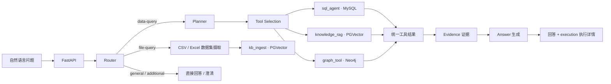

# Multi-Source Data Agent

基于 **FastAPI + LangGraph** 的多源数据分析 Agent。用自然语言查询 MySQL 业务数据、PGVector 企业知识和 Neo4j 实体关系，在 Vue 控制台查看回答、SQL/Cypher、来源证据与执行耗时。

**Python 3.10–3.12 · Vue 3 · Docker Compose · [Apache 2.0](LICENSE)**

[快速开始](#快速开始) · [界面与示例](docs/SHOWCASE.md) · [系统架构](docs/ARCHITECTURE.md) · [12-case 评测报告](eval/reports/enterprise_retail_v1_initial.md) · [API 文档](docs/API_CONTRACT.md)

> 默认业务域为 **Synthetic Enterprise Retail**，全部演示数据均为合成数据。适用于本地运行与工程验证；生产部署要求见[已知限制](docs/KNOWN_LIMITATIONS.md)。

## 真实前端演示


*2026-10-23 从真实 Vue 前端提交问题后截取。SQL、Graph、RAG 三条请求均返回 HTTP 200 和 execution success；截图展示实际响应，未模拟接口或注入回答。这是三条演示请求，完整历史评测另列于下文。*

| 场景 | 实际返回 | 截图 | 原始操作录屏 |
| --- | --- | --- | --- |
| MySQL Text2SQL | retail_orders 共 **12 个订单**，SQL 与 mysql 证据可查看 | [提问](docs/assets/query-sql-question.png) · [回答](docs/assets/query-sql-answer.png) · [证据](docs/assets/query-sql-evidence.png) | [查看 / 下载 SQL 录屏](docs/assets/demo-sql.webm) |
| Neo4j Graph | Aurora ANC Headphones 由 **NorthStar Electronics** 供货 | [提问](docs/assets/query-graph-question.png) · [回答](docs/assets/query-graph-answer.png) · [证据](docs/assets/query-graph-evidence.png) | [查看 / 下载 Graph 录屏](docs/assets/demo-graph.webm) |
| PGVector RAG | 电子产品非质量问题退货期限为 **7 个自然日**，文档来源与引用可查看 | [提问](docs/assets/query-rag-question.png) · [回答](docs/assets/query-rag-answer.png) · [证据](docs/assets/query-rag-evidence.png) | [查看 / 下载 RAG 录屏](docs/assets/demo-rag.webm) |

录屏由 Playwright 操作真实页面，包含打开控制台、提问、实际等待、回答和证据面板滚动，无加速剪辑或旁白。文件为 WebM；GitHub 未直接预览时可下载后用浏览器播放。环境与耗时见[演示详情](docs/SHOWCASE.md)和[验证记录](docs/VALIDATION.md)。

<details>
<summary>查看 Graph 与 RAG 的实际回答界面</summary>


</details>

<details>
<summary>查看产品首页</summary>


</details>

## 能力一览

| 能力 | 典型问题 | 控制台可验证的内容 |
|---|---|---|
| **Text2SQL · MySQL** | 订单统计、分组聚合、筛选查询 | 生成的 SQL、执行状态、结果数量、`sql_row` Evidence、耗时 |
| **RAG · PGVector** | 退货政策、供应商 SLA、业务 SOP | 文档 Evidence、来源 ID、引用与耗时 |
| **Graph · Neo4j** | 商品、供应商、品类之间的关系 | 图查询执行结果、`graph_record` Evidence、查询语句（如有返回） |
| **SQL 安全策略** | 请求执行 DELETE 等写操作 | 显式策略拒绝状态，不执行被禁止的写操作 |

> **评测基线说明：** 公开报告记录的是 2026-09-28 的 12-case 单轮历史基线，不是当前代码的重新实测，也不是生产 SLA。请结合[评测摘要](eval/reports/enterprise_retail_v1_initial.md)中的失败案例、Evidence 支持率与延迟一起解读。

## 请求如何运行



Router 负责选择对话、澄清、数据查询或文件摄取流程；Planner 和 Tool Selection 负责数据任务及工具选择。正式数据工具只有三个：

- **SQL**：Text2SQL 查询 MySQL。SQLGlot 解析和校验表、字段及歧义，配合只读策略、结果行数上限、数据库超时和最多一次受控修复。
- **RAG**：通过 `kb_ingest` 检索 PGVector 中的政策、SOP、供应商 SLA 等文档。企业零售与历史 Recipe 文档使用显式 domain 隔离，摄取采用稳定文档身份去重。
- **Graph**：查询 Neo4j 中的商品、供应商、品类和活动关系；内部使用预定义 Cypher，并可转入动态 Text2Cypher。

三类工具统一返回数据、执行状态和 Evidence。HTTP 响应保留 `message`、`route`、`sources` 等字段，同时提供版本化的 `execution` 字段，展示任务、工具结果预览、证据、引用、耗时及回退原因。详情见 [API 契约](docs/API_CONTRACT.md)。

几个工程取舍：工具按结构化事实、文档知识、实体关系划分，检索后端和图查询策略留在工具内部；SQL 安全由确定性校验与执行限制共同保证；回答和评测使用同一条证据链。Planner 当前支持独立子任务并行与证据聚合，尚不支持把上一步结果动态传入下一步的依赖调度。

## 技术栈与目录

| 层次 | 技术与位置 |
| --- | --- |
| API 与编排 | Python、FastAPI、LangGraph；`multisource_data_agent/` |
| 结构化数据 | MySQL、SQLGlot；`multisource_data_agent/application/agents/text2sql/` |
| 知识检索 | PostgreSQL/PGVector、Reranker；`kb_ingest/` |
| 关系数据 | Neo4j、Cypher；`multisource_data_agent/application/agents/tool_execution/` |
| 控制台 | Vue 3、TypeScript、Vite；`web/` |
| 验证与演示 | Pytest、HTTP Eval；`tests/`、`eval/`、`demo/enterprise_retail/` |

默认 Docker Compose 启动 `backend`、`mysql`、`neo4j`、`kb_postgres`、`kb_ingest` 五个服务；Vue 控制台单独启动。本公开快照不包含历史 Recipe 数据、词典或 Milvus/LightRAG 运行资产；部分旧名称仅在兼容源码中保留。

## 示例问题

1. 请使用 MySQL 查询 `retail_orders` 当前一共有多少个订单。
2. 使用 MySQL 统计各商品品类的销售件数，并按销量从高到低排序。
3. Aurora ANC Headphones 由哪个供应商供货？
4. 电子产品无质量问题的情况下，多少天内可以申请退货？
5. 退款率超过 15% 后应该执行什么处理流程？

其中 SQL、图谱和知识库分别展示结构化事实、实体关系和文档规则。演示数据及固定案例见 [Enterprise Retail Demo](docs/ENTERPRISE_RETAIL_DEMO.md)。

## 快速开始

需要 Docker Compose、Python 3.10–3.12（推荐 3.12）；运行 Vue 控制台还需要 Node.js/npm。LLM、Embedding 和 Reranker 使用外部服务，需自行填写有效配置，调用可能产生费用。

```powershell
# Windows PowerShell；在仓库根目录运行
python -m venv .venv
.\.venv\Scripts\Activate.ps1
python -m pip install -r requirements.txt
python -m pip check
Copy-Item .env.example .env
# 编辑 .env，填写 LLM / Embedding / Reranker 等连接信息
docker compose up -d --build
curl.exe http://localhost:8000/ready
python .\demo\enterprise_retail\bootstrap.py
python -u .\demo\enterprise_retail\smoke.py
```

沿用旧版 `.env` 的用户需按[部署说明](docs/DEPLOYMENT.md)迁移 `GUSTOBOT_` 前缀变量；通用的数据库和模型配置键保持原名。

后端依赖统一声明在 `pyproject.toml`；`requirements.txt` 安装当前项目及开发/摄取测试依赖，Docker 安装同一项目的 `deploy` extra。独立 `kb_ingest` 服务使用自己的依赖文件。当前声明是兼容范围而非完整依赖锁文件。

在 Linux/macOS 下，将激活命令改为 `source .venv/bin/activate`，复制命令改为 `cp .env.example .env`。首次初始化会向三个数据源写入**合成演示数据**；已有数据环境应先阅读 [快速启动](docs/QUICK_START.md) 和 [部署说明](docs/DEPLOYMENT.md)。API 文档可在本地查看 `http://localhost:8000/docs`。

可选的 Vue 控制台：

```powershell
cd web
npm ci
npm run dev
```

Compose 的主机端口默认只绑定 `127.0.0.1`。其中的固定数据库口令和关闭鉴权的 Neo4j 设置仅用于**隔离的本地演示环境**；不要改成公网监听后直接部署，也不要提交包含真实密钥的 `.env`。

## 测试与评测

单元及契约回归测试：

```powershell
python -m pytest -q
```

[CI 配置](.github/workflows/ci.yml)在 push/PR 时检查 Python 3.10/3.12 的确定性测试、依赖一致性、wheel 安装导入、前端 lint/build 和 Compose 配置，不调用外部模型或数据库。CI 状态以 GitHub Actions 的执行记录为准，本地验证单独记录。

有日期和验证范围的构建、回归及部分真实 HTTP 结果见[验证记录](docs/VALIDATION.md)。其中保留未通过项，不替代下面的完整历史基线。

正式企业零售评测集在 [`eval/datasets/enterprise_retail_v1.jsonl`](eval/datasets/enterprise_retail_v1.jsonl)，共 **12 条** SQL、Graph、RAG 与对照用例。Runner 通过真实 `POST /api/v1/chat/` 请求评测完整 Agent 链路，而非直接调用工具函数。运行前需启动服务并初始化演示数据：

```powershell
python eval/run_eval.py --dataset eval/datasets/enterprise_retail_v1.jsonl --base-url http://localhost:8000 --output-dir eval/results/enterprise_retail_v1 --timeout 600 --retry-count 0
```

下面是 **2026-09-28 的单轮初始基线**，不是当前代码的重新实测值，也不是整体 Agent 正确率或服务 SLA。原始运行产物保存在本地忽略目录 `eval/results/`；仓库提供[脱敏逐 case 摘要](eval/reports/enterprise_retail_v1_initial.md)和[评测口径说明](docs/EVALUATION.md)。

| 指标 | 首轮结果 |
| --- | ---: |
| HTTP 请求成功率 | 100% |
| 路由准确率 | 100% |
| 工具选择准确率 | 100% |
| 工具执行成功率 | 81.82% |
| 执行状态准确率 | 91.67% |
| 回答事实覆盖率（字面匹配） | 83.33% |
| 预期事实受 Evidence 支持率 | 77.78% |
| 总耗时 p95 | 155.4 秒 |

首轮有一次 SQL 工具约 100 秒超时；拒绝写操作属于预期的安全错误，也会影响“工具执行成功率”的解释。中英文事实表述不同会使字面匹配低估语义正确性，因此事实覆盖率不能被称为严格的 grounded faithfulness。请同时阅读[逐项限制与指标定义](docs/EVALUATION.md)。

另提供 [6 条自然提问补充用例](eval/datasets/enterprise_retail_natural_v1.jsonl)，用于检查不指定工具的提问和 SQL＋RAG 联合回答。补充集增加独立的数值、行字段对应与显式等价表述断言，原 v1 和历史指标不变；当前尚无该补充集的真实 HTTP 实测成绩。

## 已知边界

- 外部模型和检索服务的延迟会影响端到端运行；一次评测不足以给出稳定 SLA。
- 文件摄取接口当前返回提交确认，不能据此宣称异步任务已处理完成。
- 会话检查点主要位于进程内；重启和多副本持久化不属于当前演示能力。
- 本地演示配置没有生产环境的认证、RBAC、租户隔离或完善的密钥管理。
- 本公开快照不分发历史 Recipe 数据、词典与 `core_v1` 评测集。

更多背景见[架构说明](docs/ARCHITECTURE.md)、[完整文档索引](docs/README.md)与[已知限制](docs/KNOWN_LIMITATIONS.md)。

## 许可证与归属

项目根目录提供 [Apache License 2.0](LICENSE)。依赖及运行时加载的第三方组件遵循各自许可证；APOC 通过官方 Neo4j 镜像插件配置加载，不在仓库中分发 JAR。详见[第三方组件与数据归属](THIRD_PARTY_NOTICES.md)。合成演示数据不代表真实公司数据。
