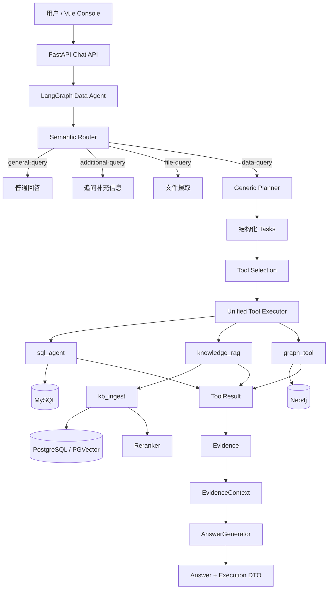

# GustoBot 当前系统架构说明

## 1. 架构目标

GustoBot 已从早期“多个 route-specific workflow + 多套 RAG/KG/Chatbot 能力”逐步收敛为一个统一的多源 Data Agent：

```text
Request
→ Semantic Router
→ Generic Planner
→ Canonical Tool Selection
→ Unified Tool Execution
→ ToolResult
→ Evidence
→ EvidenceContext
→ AnswerGenerator
→ Execution DTO
```

架构收敛的目的不是减少功能本身，而是让每一层的职责清楚、可测试、可追踪、可评估。

## 2. 顶层请求链路



## 3. Router、Planner、Tool Selection 的职责差异

### 3.1 Semantic Router

Router 判断的是**产品处理路线**：

```text
general-query
additional-query
data-query
file-query
```

Router 不直接承担 SQL/RAG/Graph 的细粒度选择，避免把产品路由和底层数据源绑定在一起。

### 3.2 Generic Planner

只有 `data-query` 进入 Planner。Planner 把复杂自然语言问题拆成结构化任务，例如：

```json
[
  {
    "task_id": "task_1",
    "question": "统计 Aurora ANC Headphones 的销量",
    "tool_hint": "auto",
    "depends_on": []
  },
  {
    "task_id": "task_2",
    "question": "查询该产品供应商",
    "tool_hint": "auto",
    "depends_on": []
  }
]
```

当前 `depends_on` 是任务描述能力，不应宣传为完整依赖式 scheduler。无依赖 task 可并行执行；复杂 blocking DAG 仍是已知限制。

### 3.3 Tool Selection

Tool Selection 针对每一个 task，从三个 canonical tools 中选择：

```text
sql_agent
knowledge_rag
graph_tool
```

典型语义：

| 问题类型 | 优先工具 |
|---|---|
| COUNT、SUM、AVG、GROUP BY、明细、Top N | `sql_agent` |
| 政策、SOP、制度、文档事实 | `knowledge_rag` |
| 实体关系、供应商、品类、活动关联 | `graph_tool` |

工具选择依赖语义 Prompt 和结构化输出，而不是简单的关键词 `if/else`。

## 4. Unified Tool Execution

三个工具都对外遵守统一执行边界：

```text
execute(task, context=None, trace=None) -> ToolResult
```

上层不需要知道每个工具内部使用哪些 client、HTTP endpoint 或数据库 driver。

### 4.1 `sql_agent`

```text
Task
→ Schema Retrieval
→ Query Analysis
→ SQL Generation
→ SQLGlot Validation
→ Read-only / Schema Safety
→ LIMIT / Timeout
→ MySQL
→ bounded repair（必要时最多一次）
→ ToolResult
```

### 4.2 `knowledge_rag`

```text
Task + domain/dataset context
→ kb_ingest
→ PGVector candidate retrieval
→ Reranker
→ Documents
→ ToolResult
```

### 4.3 `graph_tool`

```text
Task
→ predefined Cypher strategy
→ dynamic Text2Cypher fallback（必要时）
→ Neo4j
→ Records
→ ToolResult
```

## 5. ToolResult 与 Evidence

### 5.1 ToolResult

ToolResult 表示工具执行本身：

```text
tool_name
tool_kind
status
task
statement
data
answer
evidence
evidence_ids
metadata
```

status：

```text
success
empty
error
```

`empty` 是合法业务状态，不等于异常。

### 5.2 Evidence

Evidence 表示可以用于最终回答的事实依据：

```text
evidence_id
kind
source
source_id
content
score
rank
retrieval_score
rerank_score
task_id
metadata
```

映射：

| Tool | Evidence kind | Source |
|---|---|---|
| `sql_agent` | `sql_row` | `mysql` |
| `knowledge_rag` | `document` | `pgvector` |
| `graph_tool` | `graph_record` | `neo4j` |

`evidence_id` 使用确定性 task-scoped ID，例如：

```text
ev_task_1_1
```

`source_id` 是底层数据来源身份，不能和 `evidence_id` 混用。

## 6. AnswerGenerator

回答生成层统一消费 EvidenceContext：

```text
ToolResult(s)
→ Evidence(s)
→ EvidenceContext
→ AnswerGenerator
→ answer + citation_ids
```

这样 SQL、RAG、Graph 可以共同回答一个多源问题，而不是每个工具各自生成一套最终答案。

## 7. 多工具请求

例如：

> “分析 Aurora ANC Headphones 的销量、供应商，并结合电子产品退货政策给出运营说明。”

Planner 可拆为：

```text
task_1 → 销量 → sql_agent
task_2 → 供应商 → graph_tool
task_3 → 退货政策 → knowledge_rag
```

无依赖 task 可并行，最终 Evidence 统一合并。如果某一工具失败但其他工具成功，整体请求可返回 `partial`。

## 8. Execution DTO

正式 HTTP 边界：

```json
{
  "contract_version": "1",
  "status": "success | empty | partial | error",
  "tasks": [],
  "tool_results": [],
  "evidence": [],
  "citation_ids": [],
  "timings": {},
  "fallback_reason": "none"
}
```

内部完整 LangGraph State 不作为公共 API。

## 9. Reliability 模型

### 9.1 Timeout budget

当前应用层预算：

```text
Router          60s
Tool attempt   100s
Whole Agent    300s
```

SQL、PGVector、Reranker 还有更细的内部 timeout。

### 9.2 Retry

仅对明确 transient failure 做 bounded retry，例如：

- 429（非 billing/quota 类）
- 502
- 503
- connection/transport error

不把以下问题混入普通 retry：

- policy rejection
- SQL/Cypher validation failure
- auth/permission
- billing/credit
- timeout
- deterministic tool error

### 9.3 Fallback

`fallback_reason` 只描述真实 alternate strategy，例如 Router fallback 或 Graph strategy fallback；`empty`、`error` 本身不是 fallback。

## 10. RAG 数据平面

当前知识库稳定身份：

```text
(domain, dataset_id, source_id)
```

Enterprise Retail：

```text
domain = enterprise_retail
```

Recipe legacy：

```text
domain = recipe
```

schema migration 已移动到 `kb_ingest` 启动阶段，正常 search path 不再执行重型 DDL、历史回填和重复清理。

## 11. Runtime topology

默认 Compose：

```text
backend
mysql
neo4j
kb_postgres
kb_ingest
```

职责：

- `backend`：FastAPI、LangGraph、Router/Planner/Tools、Chat API。
- `mysql`：业务结构化数据。
- `neo4j`：图关系数据。
- `kb_postgres`：知识文档与 PGVector。
- `kb_ingest`：数据摄取、Embedding、检索、Rerank。

## 12. 状态与持久化边界

LangGraph 当前仍使用进程内 `MemorySaver` 作为 checkpoint。聊天历史另有关系库持久化，但这不等于完整恢复 LangGraph checkpoint。进程重启、多 worker、一致性恢复属于生产化扩展，不是当前 demo 的完成范围。
