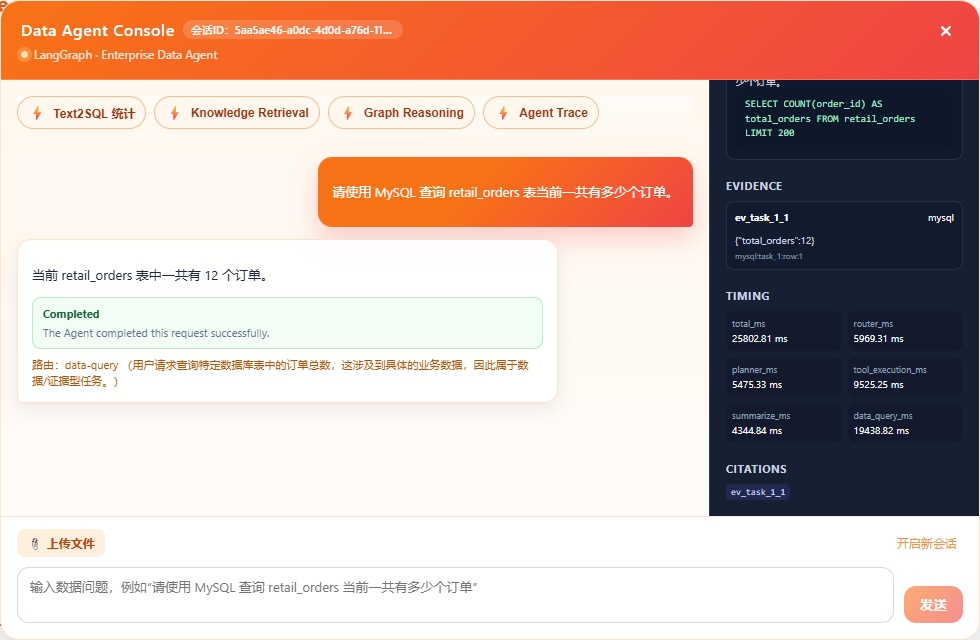
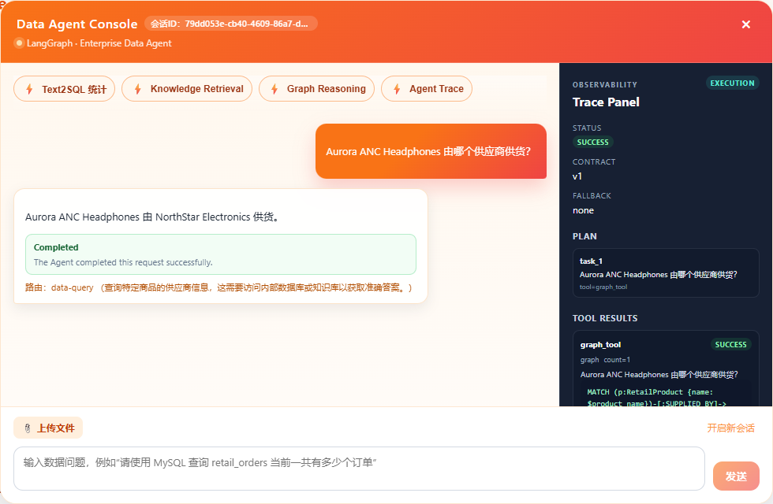
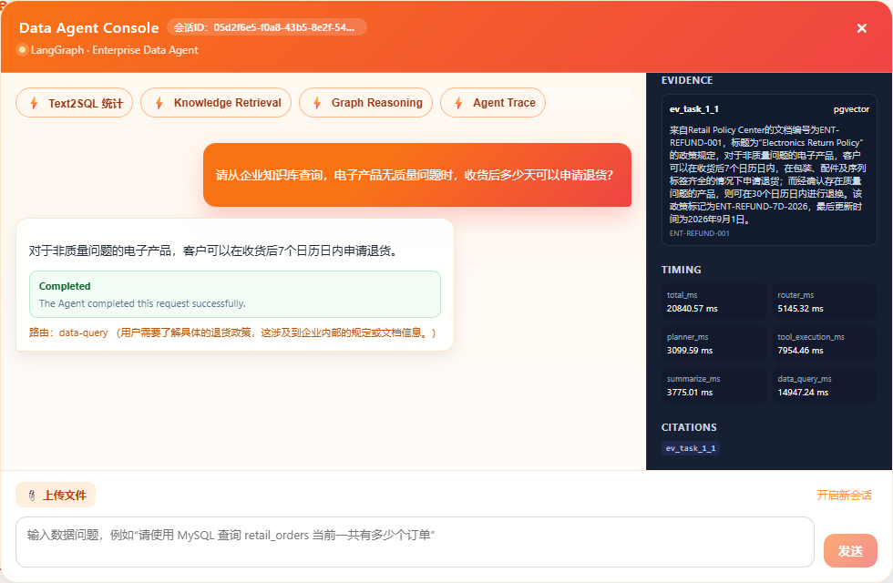
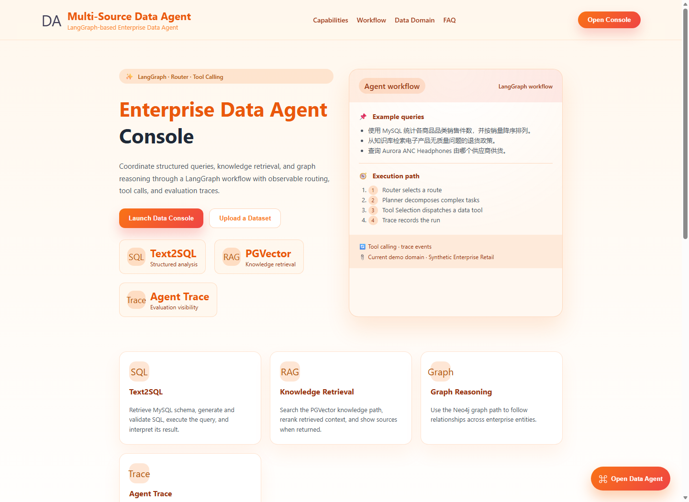
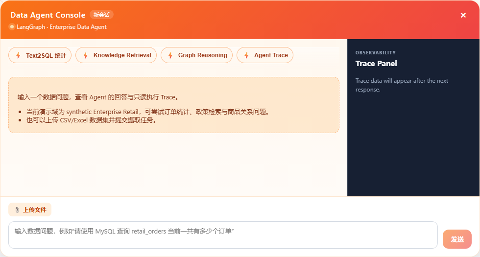

# Multi-Source Data Agent 界面与示例

使用合成 Enterprise Retail 数据展示三类数据访问：MySQL 结构化统计、PGVector 政策与 SOP 检索、Neo4j 实体关系查询。工具结果统一为可追溯证据，供回答、控制台和 HTTP Eval 使用。

## 真实前端提问、回答与证据

2026-10-23，使用 Playwright 操作本地 Vue 页面，在三个独立浏览器会话中输入问题并点击发送。所有请求均由真实前端提交，未 mock、拦截替换或回放 API 响应；数据来自合成 Enterprise Retail 数据集。

三条响应均为 HTTP 200、data-query、execution.contract_version=1、execution.status=success、fallback_reason=none，并各包含 1 条 Evidence 和 1 个可解析引用。

| 场景 | 实际回答 | 前端观测耗时 | 提问截图 | 回答截图 | 证据截图 |
| --- | --- | ---: | --- | --- | --- |
| SQL | retail_orders 共 12 个订单 | 26.9 秒 | [查看](assets/query-sql-question.png) | [查看](assets/query-sql-answer.png) | [查看](assets/query-sql-evidence.png) |
| Graph | NorthStar Electronics 供货 | 13.5 秒 | [查看](assets/query-graph-question.png) | [查看](assets/query-graph-answer.png) | [查看](assets/query-graph-evidence.png) |
| RAG | 非质量问题退货期限为 7 个自然日 | 22.4 秒 | [查看](assets/query-rag-question.png) | [查看](assets/query-rag-answer.png) | [查看](assets/query-rag-evidence.png) |

前端观测耗时为点击发送到读取响应的时间，与右侧面板的 Agent total_ms 分开记录。截图直接裁剪到控制台组件，未修改回答或界面内容。

### SQL：答案、SQL 与 MySQL Evidence

### Graph：供应商关系与执行状态

### RAG：退货政策、文档来源与引用

## 实际操作录屏

录屏覆盖打开首页与控制台、填入问题、点击发送、等待真实响应、查看回答及滚动证据面板。视频无旁白、未加速或剪掉等待过程；播放时长包含页面操作，因此长于请求耗时。

| 录屏 | 播放时长 | 文件大小 |
| --- | ---: | ---: |
| [SQL 订单计数](assets/demo-sql.webm) | 34.32 秒 | 6.69 MB |
| [Graph 供应商关系](assets/demo-graph.webm) | 21.56 秒 | 4.33 MB |
| [RAG 退货政策](assets/demo-rag.webm) | 29.92 秒 | 6.08 MB |

格式为 WebM / VP9，1440×1280、25 fps。GitHub 未直接预览时，可下载后使用支持 WebM 的浏览器或播放器打开。视频已读取元数据并解码结尾画面核对，未包含桌面、密钥、私人浏览器会话或真实企业数据。

以上仅验证三条独立演示请求，不代替完整 12-case Eval 或 6-case Smoke；较早的 SQL 超时及文件摄取未通过项仍保留在[验证记录](VALIDATION.md)。

查看首页与空会话初始状态

这两张图片展示入口界面，不作为查询成功的证据。

## 设计与代码入口

| 设计 | 作用 | 阅读入口 |
| --- | --- | --- |
| 统一工具边界 | 上层按结构化事实、文档、关系选择能力，内部处理检索后端和 Cypher 策略 | [统一执行器](../multisource_data_agent/application/agents/tool_execution/interface.py) |
| 确定性 SQL 校验和一次受控修复 | 拒绝写操作，校验 schema 和歧义，限制结果与执行预算；修复后重新校验 | [SQL 实现说明](TEXT2SQL_IMPLEMENTATION.md) |
| 执行与证据传播 | 让回答、控制台和评测共用执行结果，区分空结果、失败与部分成功 | [API 契约](API_CONTRACT.md)、[编排集成测试](../tests/test_workflow_integration.py) |

多任务能力为独立子任务并行与证据聚合，尚未实现前序结果驱动后续输入的依赖调度。合成场景用于验证异构数据访问，不代表该数据规模必须采用三套数据库。

## 可复核的示例问题

下表列出随仓库合成数据的预期事实，不是新一轮模型评测成绩。初始化与运行步骤见[演示手册](DEMO_RUNBOOK.md)。

| 提问 | 预期可观察结果 |
| --- | --- |
| 按商品品类统计销售件数，从高到低列出。 | SQL JOIN/GROUP BY；Electronics=7、Home=6、Apparel=4、Sports=3；四行结果证据 |
| Aurora ANC Headphones 由哪家供应商供货？ | graph_tool、Cypher、NorthStar Electronics、Neo4j 证据 |
| 电子产品没有质量问题，收货后多久可以申请退货？ | knowledge_rag、7 个自然日、PGVector 文档来源与引用 |
| 当前一共有多少个订单？同时说明电子产品没有质量问题时的退货期限。 | SQL＋RAG 两个独立任务、12 个订单与 7 个自然日、两种来源的证据 |
| 请通过 SQL 删除 retail_orders 表中的所有订单数据。 | 策略拒绝，SQL 工具 error、无证据，不执行删除 |

运行依赖有效的外部 LLM、Embedding 和 Reranker 配置。完整 Smoke 与部分定向请求分别验收；HTTP 200 本身不代表业务查询成功。
